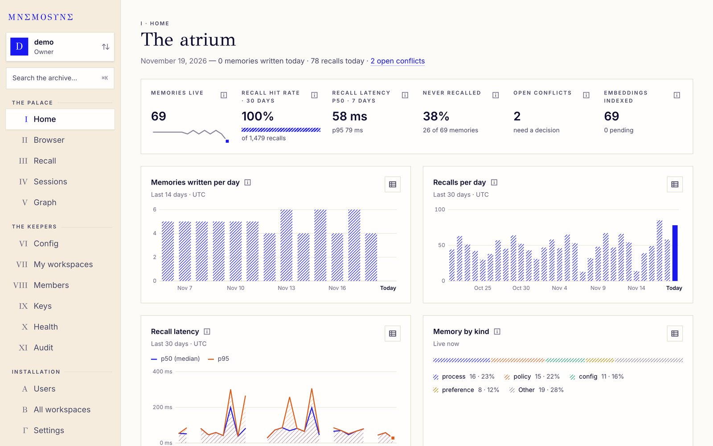
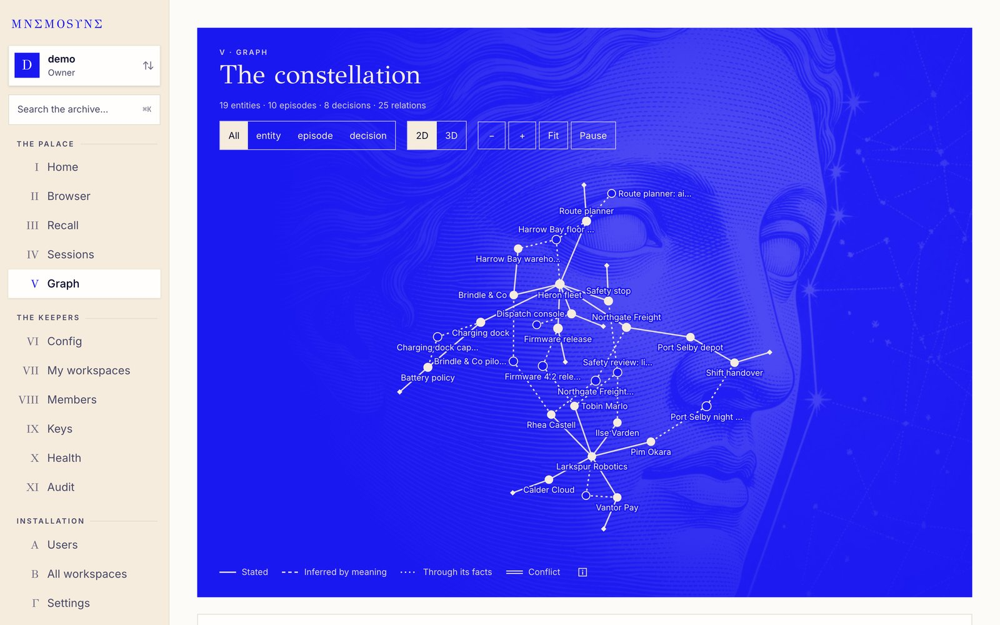
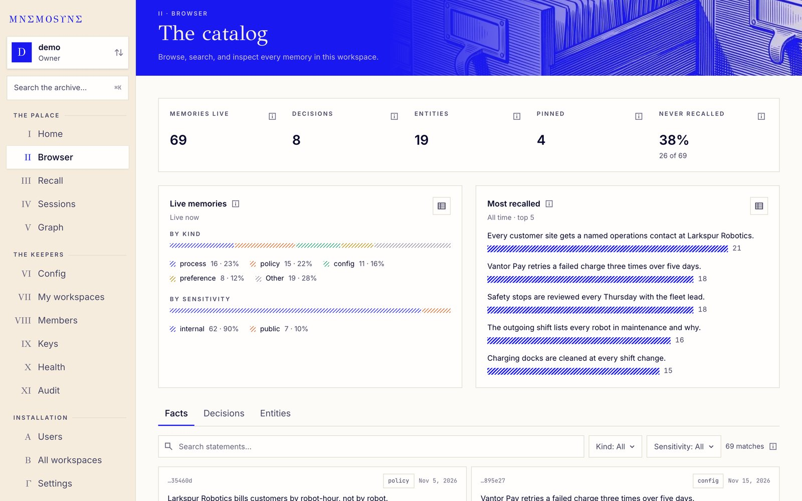
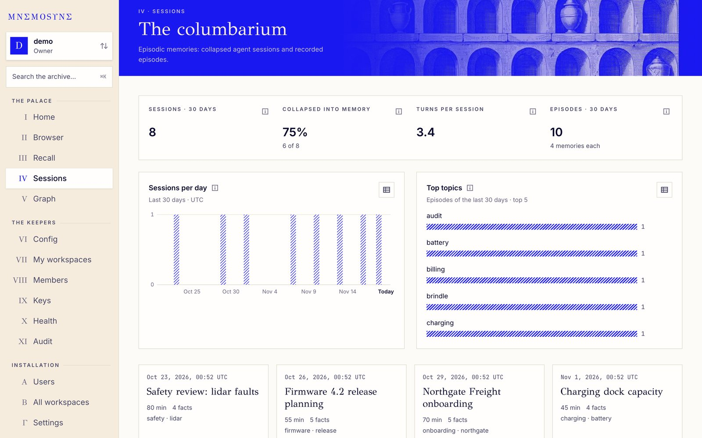
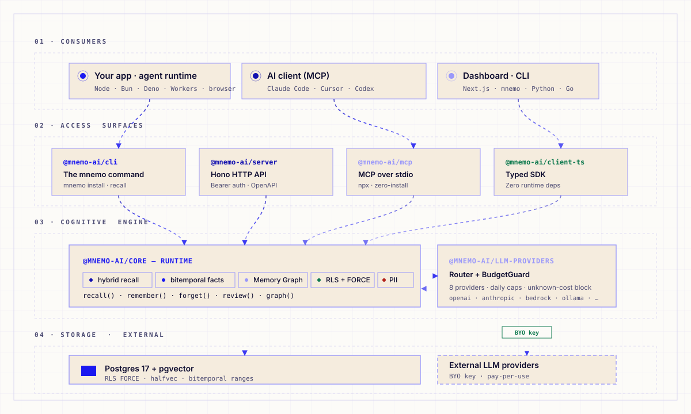
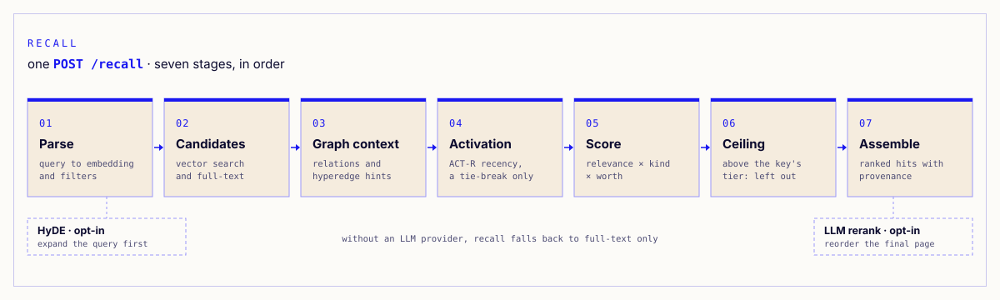
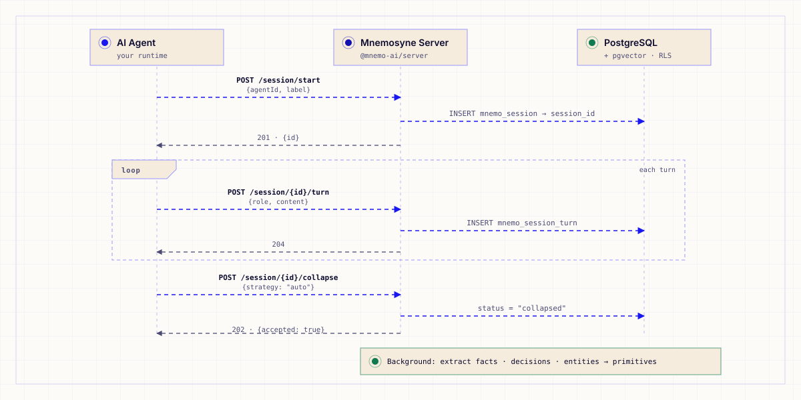
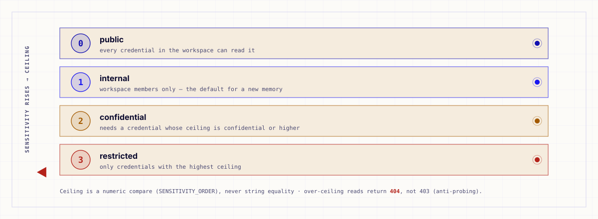

<div align="center">


# Mnemosyne

[English](README.md) · **Español**

**Memoria de largo plazo para agentes de IA, que sabe qué era cierto, cuándo y quién puede verlo. Autoalojada en tu propio Postgres.**

[](./LICENSE)
[](https://www.npmjs.com/package/@mnemo-ai/cli)
[](https://nodejs.org)
[](./docs/STATUS.md)

[Inicio rápido](#inicio-rápido) · [Dashboard](#abrir-el-dashboard) · [Qué obtienes](#qué-obtienes) · [Cómo funciona](#cómo-funciona) · [Paquetes](#paquetes) · [Documentación](#documentación)

</div>

---

Mnemosyne es un servidor de memoria de código abierto para agentes de IA. Los agentes escriben lo que aprenden y lo vuelven a pedir por un servidor MCP, un CLI, un cliente con tipos o la API REST; las personas lo ven en un dashboard web. Todo vive en tu propio Postgres.

Los agentes olvidan: cada conversación empieza de cero. Pegar en el prompt fragmentos de un almacén de vectores lo disimula y suma tres problemas que crecen con la escala:

- **Sin procedencia.** Vuelve un fragmento, pero nadie puede decir de dónde salió, cuánta confianza merece o si sigue siendo cierto.
- **Sin tiempo.** "Acme está en Pro" y "Acme pasó a Enterprise" son solo dos vectores. Nada dice cuál vale hoy ni qué se creía el 1 de marzo.
- **Sin aislamiento.** Una memoria compartida por varios clientes y separada solo con un `WHERE workspace_id = ?` está a una cláusula olvidada de una fuga.

Mnemosyne guarda memorias con tipo, con su origen, su confianza y el período en que valen, y deja que la base de datos mantenga separado cada espacio de trabajo.

**Te sirve** si tus agentes atienden a varios usuarios o clientes, si necesitas auditar qué sabía un agente en un momento dado o si quieres la memoria en tu propia infraestructura. **Es más de lo que necesitas** para un cuaderno de un solo usuario que solo busca por similitud: con pgvector alcanza.

> **Alfa.** Los caminos principales funcionan y están probados contra Postgres real, y la API todavía puede cambiar dentro de la serie 3.x. [`docs/STATUS.md`](./docs/STATUS.md) lista qué es estable, beta o planificado. Solo autoalojado: no hay un servicio en la nube.

## Inicio rápido

Necesitas Docker y una clave de una API de modelos: Mnemosyne no trae ningún modelo y funciona con el que conectes. El stack levanta Postgres con pgvector, Redis y el servidor. La primera vez construye las imágenes: calcula entre 5 y 15 minutos.

```bash
git clone https://github.com/lucasmailland/mnemosyne
cd mnemosyne/docker
cp .env.example .env
echo "MNEMO_DASHBOARD_SECRET=$(openssl rand -hex 32)" >> .env
$EDITOR .env    # uncomment one model block and add its key
docker compose up -d
```

`docker/.env.example` tiene bloques listos para OpenAI, Google Gemini, Anthropic con embeddings de Voyage y modelos locales; descomenta uno. Los modelos locales son opcionales: Ollama arranca solo con `docker compose --profile local up -d`, `bge-m3` (MIT) es el modelo de embeddings sugerido y no se elige ningún modelo de completados por ti; elige uno cuya licencia se ajuste a tu uso (`qwen2.5:3b`, por ejemplo, no permite el uso comercial). Sin proveedor el servidor arranca igual y registra qué falta; entonces el recall cae a la búsqueda de texto completo y las escrituras responden 501 hasta que configures un proveedor de embeddings. [`docker/README.es.md`](./docker/README.es.md#elige-una-api-de-modelos) tiene los detalles. El secreto permite que el dashboard inicie sesión. Espera a que el servidor informe todos los chequeos en `ok`, incluidos los embeddings:

```bash
curl http://localhost:3939/health/ready
```

```json
{
  "status": "ready",
  "degraded": false,
  "checks": { "postgres": "ok", "vector": "ok", "cache": "ok", "embed": "ok" }
}
```

Genera la primera clave de API desde la terminal. Se muestra una sola vez, así que cópiala:

```bash
docker compose exec server node scripts/create-api-key.cjs --label "my laptop"
```

Guarda algo y después pídelo con otras palabras:

```bash
curl -X POST http://localhost:3939/remember \
  -H "Authorization: Bearer mns_live_..." \
  -H "Content-Type: application/json" \
  -d '{"statement": "Acme prefers communication in Spanish."}'

curl -X POST http://localhost:3939/recall \
  -H "Authorization: Bearer mns_live_..." \
  -H "Content-Type: application/json" \
  -d '{"query": "what language should we use with Acme?", "topK": 5}'
```

El recall encuentra la memoria por su significado, sin palabras en común, y la devuelve con su vigencia y su sensibilidad:

```json
{
  "hits": [
    {
      "kind": "fact",
      "content": "Acme prefers communication in Spanish.",
      "score": 0.74,
      "validFrom": "2026-11-19T00:24:12.810Z",
      "validTo": null,
      "sensitivity": "internal",
      "status": "active"
    }
  ],
  "nothingRelevant": false
}
```

> **El stack local es para probar.** Se conecta a Postgres como dueño de la base, lo que omite la seguridad a nivel de fila, así que aquí los espacios de trabajo no quedan aislados entre sí. La configuración de producción crea un rol restringido y activa el aislamiento; consulta [`docker/README.es.md`](./docker/README.es.md). Sus puertos se publican solo en `127.0.0.1`. Después de un `git pull`, ejecuta `docker compose up -d --build`: sin `--build` Compose conserva las imágenes que compiló antes.

### Conectar tus agentes

Un solo comando detecta Claude Code, Cursor, Codex, Gemini CLI, OpenCode y Windsurf en la máquina y registra el servidor MCP en cada uno que encuentra:

```bash
npx -y @mnemo-ai/cli install
```

Capturar conversaciones completas es un paso aparte y opcional, disponible para Claude Code, Codex y OpenCode ([guía](./docs/guides/HARNESS.es.md)):

```bash
npx -y @mnemo-ai/cli install --capture claude-code,codex,opencode
```

El CLI `mnemo` también funciona por su cuenta, en inglés o en español (`MNEMO_LOCALE=es`):

```bash
npm install -g @mnemo-ai/cli
export MNEMO_URL=http://localhost:3939
export MNEMO_KEY=mns_live_...
mnemo remember "The user prefers concise responses"
mnemo recall "user preferences"
```

Para registrar solo las herramientas MCP a mano, agrega esto a la configuración de tu cliente MCP:

```json
{
  "mcpServers": {
    "mnemosyne": {
      "command": "npx",
      "args": ["-y", "@mnemo-ai/mcp"],
      "env": {
        "MNEMO_URL": "http://localhost:3939",
        "MNEMO_KEY": "mns_live_..."
      }
    }
  }
}
```

### Abrir el dashboard

Con el stack en marcha, desde la raíz del repositorio (Node 22.18 o posterior y pnpm 9). El dashboard importa los paquetes del espacio de trabajo desde su salida compilada, así que compílalos una vez antes:

```bash
pnpm install
pnpm build
MNEMO_SERVER_URL=http://localhost:3939 pnpm --filter @mnemo-ai/dashboard dev
```

Abre `http://localhost:3000/dashboard`, elige **Iniciar sesión con clave de API** y pega tu clave `mns_live_...`. Necesita la línea de `MNEMO_DASHBOARD_SECRET` del inicio rápido; sin ella el servidor corre sin interfaz y el inicio de sesión queda apagado.



<table>
  <tr>
    <td width="33%"></td>
    <td width="33%"></td>
    <td width="33%"></td>
  </tr>
  <tr>
    <td align="center"><sub>El grafo, en 2D o 3D</sub></td>
    <td align="center"><sub>El explorador</sub></td>
    <td align="center"><sub>Sesiones</sub></td>
  </tr>
</table>

El dashboard muestra qué se escribió y qué se recordó, las memorias en sí, las sesiones de las que salieron y el grafo que las conecta, además de pruebas de recall, miembros, claves de API, salud y auditoría, en inglés y en español. En producción viene en [`docker/docker-compose.prod.yml`](./docker/docker-compose.prod.yml), detrás de tu proxy HTTPS.

## Qué obtienes

202 rutas REST con OpenAPI, 37 herramientas MCP, 49 comandos de CLI y un dashboard, sobre un solo Postgres.

**Memoria**

|                               |                                                                                                                                                                                                      |
| ----------------------------- | ---------------------------------------------------------------------------------------------------------------------------------------------------------------------------------------------------- |
| **Memoria tipada**            | Diez tipos de memoria, desde hechos y decisiones hasta episodios y tareas, cada uno con su forma de recordarse y de olvidarse.                                                                       |
| **Hechos bitemporales**       | Cada hecho guarda dos tiempos: cuándo vale en el mundo y cuándo lo supo el sistema. Olvidar cierra un período; la historia nunca se borra, así que puedes preguntar qué se creía en cualquier fecha. |
| **Recall híbrido**            | Búsqueda de texto completo y búsqueda vectorial en una sola llamada, con contexto del grafo de memoria, un nivel caliente en Redis y un reordenamiento opcional con un LLM.                          |
| **De sesiones a memoria**     | Inicias una sesión, envías los turnos y la cierras: el motor extrae hechos, decisiones y entidades de la conversación.                                                                               |
| **Conflictos y correcciones** | Cuando dos hechos se contradicen, el par queda señalado y lo resuelves tú o el agente. Una corrección reemplaza el hecho y conserva su linaje.                                                       |
| **Consolidación**             | Un proceso en segundo plano fusiona duplicados y retira lo que fue reemplazado. Un hecho fijado nunca se fusiona.                                                                                    |
| **Recordatorios**             | Una memoria que vuelve sola: a una hora, o cuando una condición aparece en un recall posterior.                                                                                                      |
| **Un grafo, no una lista**    | Entidades, episodios y decisiones conectados por relaciones tipadas que llevan confianza y procedencia.                                                                                              |

**Seguridad y equipos**

|                              |                                                                                                                                                                              |
| ---------------------------- | ---------------------------------------------------------------------------------------------------------------------------------------------------------------------------- |
| **Aislamiento en la base**   | Seguridad a nivel de fila de Postgres con `FORCE` en cada tabla, así que es la base, no cada consulta, la que separa los espacios de trabajo.                                |
| **Niveles de sensibilidad**  | `public`, `internal`, `confidential` y `restricted` en cada memoria. Una clave solo lee hasta su techo.                                                                      |
| **Privacidad al escribir**   | Los datos personales se detectan y se ocultan cuando se escribe una memoria.                                                                                                 |
| **Usuarios, roles y claves** | Usuarios, organizaciones y espacios de trabajo con roles. Las claves de API llevan permisos y un techo de sensibilidad, y las acciones sensibles pueden requerir aprobación. |
| **Auditoría**                | Un registro de auditoría, una línea de tiempo de qué se aprendió y cuándo, y exportación de datos con aprobación.                                                            |

**Operación**

|                                     |                                                                                                                                               |
| ----------------------------------- | --------------------------------------------------------------------------------------------------------------------------------------------- |
| **Tu propio LLM**                   | OpenAI, Anthropic, Google, Cohere, Mistral, Voyage, AWS Bedrock o un Ollama local. No trae ningún modelo ni clave, y el gasto en LLM es tuyo. |
| **Muchas entradas**                 | Servidor MCP, CLI, cliente TypeScript con tipos, SDK de Python y de Go, REST, gRPC y WebSocket, y el dashboard.                               |
| **Eventos hacia afuera**            | Webhooks firmados con HMAC-SHA256 y suscripciones en vivo por WebSocket.                                                                      |
| **Observabilidad**                  | Chequeos de salud, un endpoint de métricas y cuatro dashboards de Grafana.                                                                    |
| **Sincronización entre servidores** | Sincronización firmada entre servidores de Mnemosyne.                                                                                         |

Varias de estas funciones están en beta; [`docs/STATUS.md`](./docs/STATUS.md) marca cada una (en inglés).

## Las 37 herramientas MCP

Un agente conectado por MCP las recibe todas, y el CLI `mnemo` cubre lo mismo. `MNEMO_MCP_TOOLS=core` reduce la lista a las 9 más usadas (recall, fact, remember, decide, update, forget, search, status, context) cuando quieres que cada request lleve menos. La referencia completa, con cada parámetro, está en [`packages/mcp/README.es.md`](./packages/mcp/README.es.md).

| Grupo                       | Qué puede hacer el agente                                                                                                                     | Herramientas                                                                                            |
| --------------------------- | --------------------------------------------------------------------------------------------------------------------------------------------- | ------------------------------------------------------------------------------------------------------- |
| **Guardar y recordar**      | Escribir una memoria, encontrarla por significado o por texto, leer una completa, ver qué cambió con el tiempo, leer el contexto de la sesión | `memory_remember`, `memory_recall`, `memory_search`, `memory_fact`, `memory_timeline`, `memory_context` |
| **Corregir y olvidar**      | Reemplazar un hecho conservando su linaje, cerrarlo, protegerlo de fusiones, moverlo a otro espacio de trabajo, borrarlo para siempre         | `memory_update`, `memory_forget`, `memory_pin`, `memory_relocate`, `memory_purge`                       |
| **Estructura**              | Entidades, relaciones tipadas entre dos memorias o entre varias, decisiones con su fundamento                                                 | `memory_entity`, `memory_relate`, `memory_hyperedge`, `memory_decide`, `memory_suggest_topic_key`       |
| **Sesiones**                | Abrir un episodio, sumar turnos, cerrarlo en hechos y decisiones, o descartarlo                                                               | `memory_session`, `memory_episode_start`, `memory_episode_end`                                          |
| **Trabajo y saber hacer**   | Tareas con responsable y estado, eventos inmutables, razonamientos guardados, estrategias, flujos y habilidades                               | `memory_task`, `memory_event`, `memory_reasoning`, `memory_strategy`, `memory_workflow`, `memory_skill` |
| **Mantenerla limpia**       | Listar y resolver contradicciones, comparar dos hechos, fusionar duplicados, reforzar o debilitar una memoria                                 | `memory_judge`, `memory_compare`, `memory_consolidate`, `memory_self_edit`                              |
| **Anticipar y reflexionar** | Recordatorios por tiempo o por condición, próximos recalls probables, cobertura y vacíos, inferencias nuevas a partir de lo que se sabe       | `memory_remind_when`, `memory_anticipate`, `memory_introspect`, `memory_compose`                        |
| **Operar**                  | Salud, estadísticas del espacio de trabajo, ocho diagnósticos, espacios de trabajo y miembros                                                 | `memory_status`, `memory_stats`, `memory_doctor`, `memory_workspace`                                    |

## Cómo funciona

El servidor es la única pieza que toca la base de datos. El CLI, el servidor MCP, los SDK y el dashboard le hablan por HTTP con una clave de API, y la clave decide el espacio de trabajo.



### Recall

Un recall recorre siete etapas en orden. ACT-R, un modelo de la memoria humana, solo desempata a favor de lo que se usó hace poco; el orden lo decide la relevancia.



### Lo que cuesta en contexto

Un recall le pone al agente de 3 a 5 recuerdos relevantes, no toda la memoria. En el benchmark fueron unos 280 a 340 caracteres por turno, con la respuesta entre ellos en el 95 a 97 % de las preguntas. Las herramientas suman una cantidad fija a cada request (unos 47 KB con las 37, 13 KB con `MNEMO_MCP_TOOLS=core`), así que con una memoria chica (menos de unos 635 recuerdos cortos, o 180 con core) pegar todo sale más barato; a medida que la memoria crece, el volcado crece con ella y el recall no. Método, números y límites: [`docs/testing/token-benchmark.md`](./docs/testing/token-benchmark.md); se reproduce con `pnpm bench:tokens`.

### Diez tipos de memoria

Un hecho, una decisión y un episodio se recuerdan, se olvidan y se consolidan distinto, así que Mnemosyne guarda el tipo junto con la memoria.

| Tipo        | Qué guarda                                                                                            | Se desvanece |
| ----------- | ----------------------------------------------------------------------------------------------------- | ------------ |
| `fact`      | Conocimiento duradero sobre un usuario, un agente o un dominio, con confianza y un período de validez | Despacio     |
| `decision`  | Una decisión con su fundamento; una posterior puede reemplazarla                                      | Despacio     |
| `strategy`  | Una regla práctica `trigger → action`, puntuada por aciertos y fallas                                 | Despacio     |
| `workflow`  | Un proceso reutilizable de varios pasos ordenados con condiciones                                     | Despacio     |
| `skill`     | Una plantilla de prompt guardada para una tarea repetible                                             | Despacio     |
| `reasoning` | Una pregunta, los pasos del razonamiento y la conclusión                                              | Despacio     |
| `episode`   | El registro acotado de una sesión o un evento                                                         | Antes        |
| `entity`    | Una persona, organización, proyecto, concepto o lugar que otras memorias mencionan                    | Antes        |
| `task`      | Una tarea con su ciclo de vida y delegación                                                           | Rápido       |
| `event`     | El registro inmutable de algo que pasó                                                                | Nunca        |

Las relaciones entre memorias también se guardan, y son lo que dibuja el grafo.

### Las sesiones se vuelven memoria



```ts
import { MnemosyneClient } from "@mnemo-ai/client-ts";

const memory = new MnemosyneClient({
  url: "http://localhost:3939",
  apiKey: process.env.MNEMO_KEY!,
});

const session = await memory.createSession({ agentId: "agent_support" });
await memory.appendTurn(session.id, { role: "user", content: "I need to cancel my subscription" });
await memory.appendTurn(session.id, { role: "assistant", content: "Done, it ends on the 30th." });
await memory.collapseSession(session.id, { strategy: "auto" });

const { hits } = await memory.recall({ query: "subscription status", topK: 5 });
```

Cerrar la sesión es lo que convierte la conversación en hechos y decisiones.

### Sensibilidad



Una lectura por encima del techo de la clave responde 404 en lugar de 403, para que nadie pueda sondear qué existe.

### El grafo de memoria


Este es un espacio de trabajo real en el dashboard. Entidades, episodios y decisiones se conectan con relaciones tipadas que llevan confianza y procedencia: algunas están declaradas, otras se infieren por significado y otras salen de los hechos que dos memorias comparten. El recall las usa como contexto, el servidor las sirve en `GET /graph` y [`examples/graph-viewer`](./examples/graph-viewer) muestra cómo dibujarlas por tu cuenta.

## Elige tu LLM

El servidor lee sus proveedores del entorno (`docker/.env` en el stack local); nada se elige por ti:

```bash
MNEMO_LLM_PROVIDER=anthropic
MNEMO_LLM_API_KEY=...
MNEMO_EMBED_PROVIDER=openai
MNEMO_EMBED_API_KEY=...
MNEMO_EMBED_MODEL=text-embedding-3-small
```

Los proveedores admitidos son `openai`, `anthropic`, `google`, `cohere`, `mistral`, `voyage`, `bedrock` y `ollama`. Si el proveedor de embeddings no responde, el recall cae a la búsqueda de texto completo; el cierre de sesiones necesita un LLM. [`docker/.env.example`](./docker/.env.example) documenta cada variable.

## Paquetes

**En npm.** Los cuatro son clientes: necesitan un servidor en marcha.

| Paquete                                       | Qué es                                                                                          |
| --------------------------------------------- | ----------------------------------------------------------------------------------------------- |
| [`@mnemo-ai/cli`](./packages/cli)             | El comando `mnemo`: recall, remember, sesiones, claves, exportar e importar, y `mnemo install`. |
| [`@mnemo-ai/mcp`](./packages/mcp)             | Servidor MCP por stdio con 37 herramientas. `npx -y @mnemo-ai/mcp`.                             |
| [`@mnemo-ai/client-ts`](./packages/client-ts) | Cliente HTTP con tipos para Node 20+, Bun, Deno, Workers y navegadores.                         |
| [`@mnemo-ai/types`](./packages/types)         | Tipos compartidos; los otros tres lo instalan por ti.                                           |

Los SDK de Python y de Go se instalan desde el repositorio:

```bash
pip install "git+https://github.com/lucasmailland/mnemosyne.git#subdirectory=packages/sdk-python"
go get github.com/lucasmailland/mnemosyne/packages/sdk-go
```

<details>
<summary>Todo lo demás que hay en el repositorio</summary>

| Paquete                                                                                                                                       | Qué es                                                                                                         |
| --------------------------------------------------------------------------------------------------------------------------------------------- | -------------------------------------------------------------------------------------------------------------- |
| [`server`](./packages/server)                                                                                                                 | API HTTP con Hono, OpenAPI 3.1, gRPC, autenticación por token y el inicio de sesión del dashboard.             |
| [`dashboard`](./packages/dashboard)                                                                                                           | El dashboard web en Next.js.                                                                                   |
| [`core`](./packages/core)                                                                                                                     | El motor: tipos de memoria, recall, hechos bitemporales, cierre de sesiones.                                   |
| [`adapter-postgres`](./packages/adapter-postgres), [`adapter-vector`](./packages/adapter-vector), [`adapter-redis`](./packages/adapter-redis) | Almacenamiento, búsqueda vectorial con pgvector y la caché.                                                    |
| [`llm-providers`](./packages/llm-providers), [`adapter-llm`](./packages/adapter-llm)                                                          | Los ocho proveedores de LLM, un enrutador y un tope de gasto.                                                  |
| [`consolidation`](./packages/consolidation), [`federation`](./packages/federation), [`plugins`](./packages/plugins), [`cup`](./packages/cup)  | Consolidación en segundo plano, sincronización firmada entre servidores, plugins y actualizaciones de esquema. |
| [`harness`](./packages/harness), [`plugin`](./packages/plugin)                                                                                | La captura de conversaciones detrás de `mnemo install --capture`, y el plugin para los hosts.                  |
| [`mock-server`](./packages/mock-server)                                                                                                       | Un simulador en memoria de la API REST para desarrollar sin conexión.                                          |

</details>

## Estado y pruebas

Alfa. [`docs/STATUS.md`](./docs/STATUS.md) dice, función por función, qué anda. GitHub Actions está apagado en este repositorio, así que no hay una insignia de CI en la que confiar: cada versión pasa una compuerta local ([`docs/RELEASING.es.md`](./docs/RELEASING.es.md)), y puedes correr las mismas suites por tu cuenta.

- `pnpm test` corre las suites unitarias y de contrato, sin necesidad de Docker. El repositorio tiene más de 1.000 archivos de pruebas.
- `pnpm test:integration` corre contra Postgres y pgvector reales en contenedores, partiendo de una base vacía y sus 79 migraciones.
- El aislamiento entre espacios de trabajo tiene sus propias pruebas con un rol de base restringido, como [`collapse-rls-nonsuperuser`](./packages/server/src/__tests__/integration/collapse-rls-nonsuperuser.integration.test.ts); [`DEBUG_RLS_ISOLATION.es.md`](./docs/guides/DEBUG_RLS_ISOLATION.es.md) explica cómo comprobarlo a mano.

Límites conocidos hoy:

- Fijar un hecho lo protege de la consolidación; no lo sube en el recall.
- Por defecto el recall busca en siete de los diez tipos; pasa `kinds` para buscar en todos.
- La captura de conversaciones registra el lado del usuario en Claude Code y OpenCode; Codex necesita tener activada su función de hooks.
- Los SDK de Python y de Go todavía no están en PyPI ni tienen etiqueta de versión.

## Desarrollo

```bash
git clone https://github.com/lucasmailland/mnemosyne
cd mnemosyne
pnpm install
pnpm build
pnpm typecheck
pnpm test
```

Para compilar hace falta Node 22.18 o posterior y pnpm 9; los paquetes publicados corren en Node 20 o posterior.

## Documentación

- [`docs/STATUS.md`](./docs/STATUS.md): qué funciona hoy (en inglés)
- [`docker/README.es.md`](./docker/README.es.md): el stack de Docker, local y de producción
- [`docs/architecture/API.es.md`](./docs/architecture/API.es.md): referencia de REST, MCP y gRPC
- [`docs/architecture/DATA_MODEL.md`](./docs/architecture/DATA_MODEL.md): los tipos de memoria, el esquema y el decaimiento (en inglés)
- [`docs/architecture/SECURITY.md`](./docs/architecture/SECURITY.md): seguridad a nivel de fila, sensibilidad y modelo de amenazas (en inglés)
- [`docs/guides/CLI.es.md`](./docs/guides/CLI.es.md): el CLI `mnemo`
- [`docs/guides/HARNESS.es.md`](./docs/guides/HARNESS.es.md): la captura de conversaciones
- [`packages/mcp/README.es.md`](./packages/mcp/README.es.md): configuración de MCP y las 37 herramientas
- [`docs/integration/SDK_INTEGRATION.es.md`](./docs/integration/SDK_INTEGRATION.es.md): cómo usar los SDK

## Contribuir

Los issues y pull requests son bienvenidos; consulta [CONTRIBUTING.es.md](./CONTRIBUTING.es.md). Las preguntas y los reportes de errores van a GitHub Issues. Lo más útil ahora es correr el inicio rápido y contarnos qué te sorprendió.

## Seguridad

Para reportar una vulnerabilidad no abras un issue público: sigue [SECURITY.es.md](./SECURITY.es.md).

## Licencia

[Apache-2.0](./LICENSE) © Lucas Mailland.

El nombre viene de Mnemósine, la titánide griega de la memoria y madre de las nueve musas.

<div align="center">
<br />

</div>
