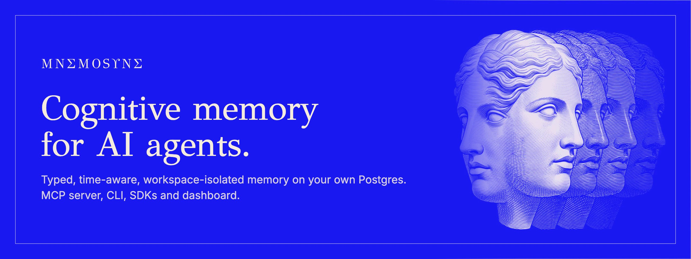
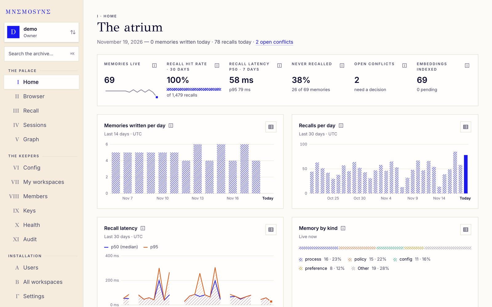
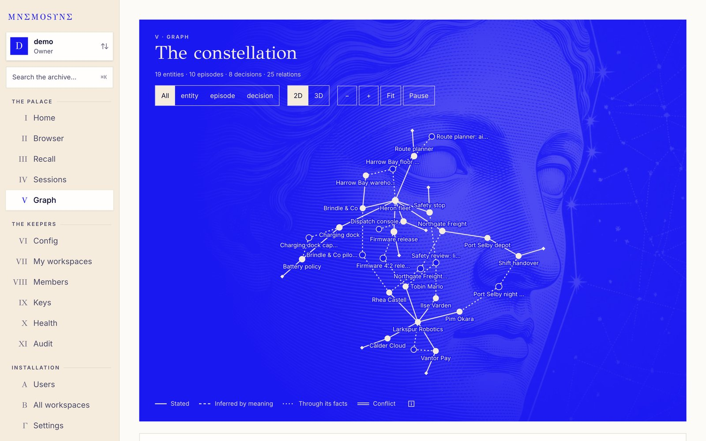
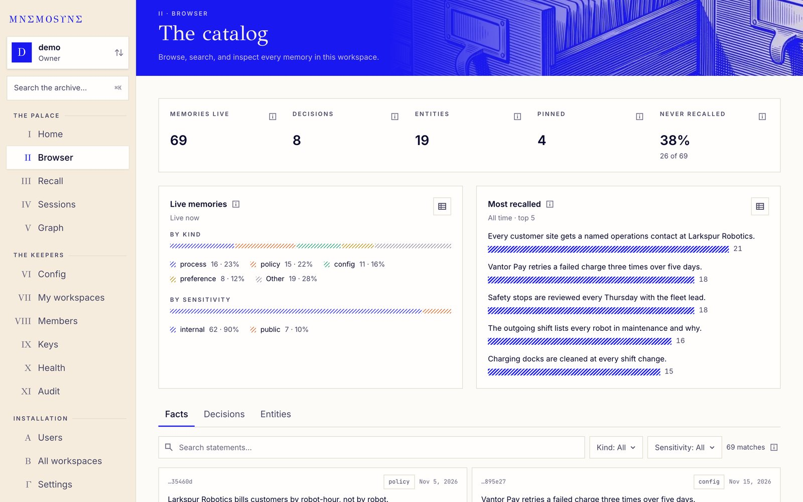
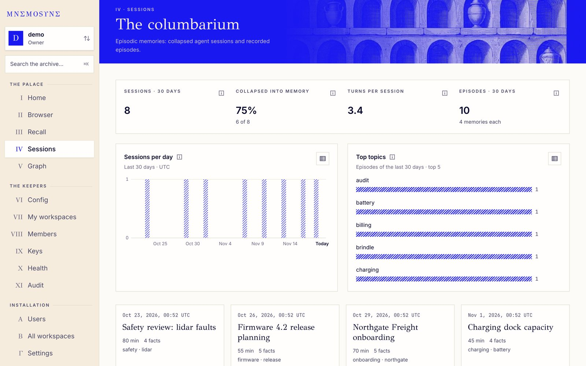
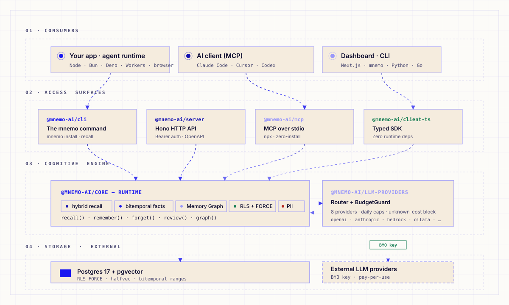
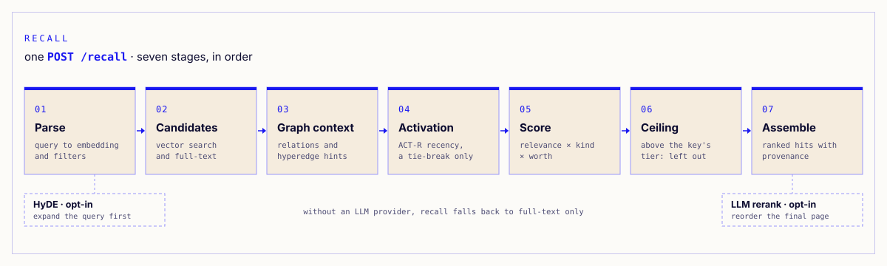
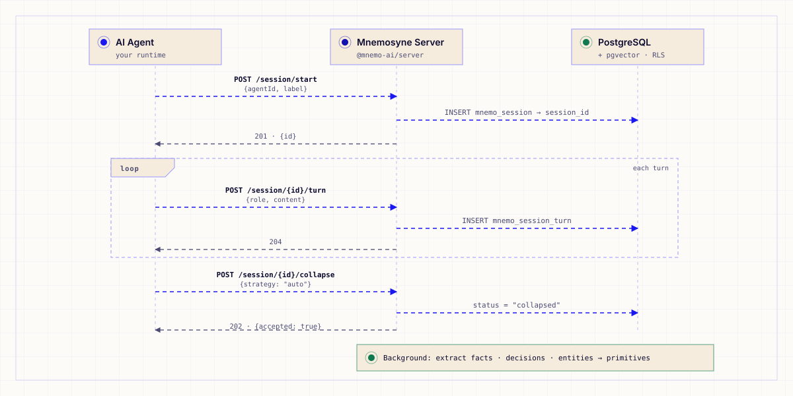
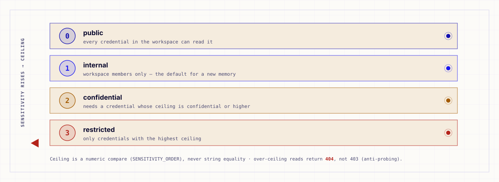

<div align="center">



# Mnemosyne

**English** · [Español](README.es.md)

**Long-term memory for AI agents that knows what was true, when, and who may see it. Self-hosted on your own Postgres.**

[](./LICENSE)
[](https://www.npmjs.com/package/@mnemo-ai/cli)
[](https://nodejs.org)
[](./docs/STATUS.md)

[Quickstart](#quickstart) · [Dashboard](#open-the-dashboard) · [What you get](#what-you-get) · [How it works](#how-it-works) · [Packages](#packages) · [Docs](#documentation)

</div>

---

Mnemosyne is an open-source memory server for AI agents. Agents write what they learn and ask for it back through an MCP server, a CLI, a typed client or the REST API; people see it in a web dashboard. Everything lives in your own Postgres.

Agents forget: every conversation starts from zero. Pasting chunks from a vector store into the prompt hides that and adds three problems that grow with scale:

- **No provenance.** A chunk comes back, but nobody can say where it came from, how sure the system is or whether it is still true.
- **No time.** "Acme is on Pro" and "Acme upgraded to Enterprise" are both just vectors. Nothing says which one holds today, or what was believed on March 1st.
- **No isolation.** Memory shared by several customers and separated only by a `WHERE workspace_id = ?` is one forgotten clause away from a leak.

Mnemosyne stores typed memories with their source, their confidence and the period in which they hold, and lets the database keep each workspace apart.

**It fits** if your agents serve several users or customers, if you need to audit what an agent knew at a given moment, or if you want the memory on your own infrastructure. **It is more than you need** for a single-user notebook that only wants similarity search: plain pgvector will do.

> **Alpha.** The main paths work and are tested against real Postgres, and the API can still change within 3.x. [`docs/STATUS.md`](./docs/STATUS.md) lists what is stable, beta and planned. Self-hosted only: there is no hosted service.

## Quickstart

You need Docker and a key for one model API: Mnemosyne ships with no model and runs on the one you connect. The stack runs Postgres with pgvector, Redis and the server. The first run builds the images: allow 5 to 15 minutes.

```bash
git clone https://github.com/lucasmailland/mnemosyne
cd mnemosyne/docker
cp .env.example .env
echo "MNEMO_DASHBOARD_SECRET=$(openssl rand -hex 32)" >> .env
$EDITOR .env    # uncomment one model block and add its key
docker compose up -d
```

`docker/.env.example` has ready blocks for OpenAI, Google Gemini, Anthropic with Voyage embeddings, and local models; uncomment one. Local models are opt-in: Ollama starts only with `docker compose --profile local up -d`, `bge-m3` (MIT) is the suggested embedder, and no completion model is chosen for you; pick one whose licence fits your use (`qwen2.5:3b`, for one, is non-commercial). With no provider the server still starts and logs what is missing; recall then falls back to full-text search and writes answer 501 until an embedder is set. [`docker/README.md`](./docker/README.md#choose-a-model-api) has the details. The secret lets the dashboard sign in. Wait until the server reports every check as `ok`, embeddings included:

```bash
curl http://localhost:3939/health/ready
```

```json
{
  "status": "ready",
  "degraded": false,
  "checks": { "postgres": "ok", "vector": "ok", "cache": "ok", "embed": "ok" }
}
```

Mint the first API key from the terminal. It is printed once, so copy it:

```bash
docker compose exec server node scripts/create-api-key.cjs --label "my laptop"
```

Remember something, then ask for it in other words:

```bash
curl -X POST http://localhost:3939/remember \
  -H "Authorization: Bearer mns_live_..." \
  -H "Content-Type: application/json" \
  -d '{"statement": "Acme prefers communication in Spanish."}'

curl -X POST http://localhost:3939/recall \
  -H "Authorization: Bearer mns_live_..." \
  -H "Content-Type: application/json" \
  -d '{"query": "what language should we use with Acme?", "topK": 5}'
```

The recall finds the memory by meaning, with no words in common, and returns it with its validity and its sensitivity:

```json
{
  "hits": [
    {
      "kind": "fact",
      "content": "Acme prefers communication in Spanish.",
      "score": 0.74,
      "validFrom": "2026-11-19T00:24:12.810Z",
      "validTo": null,
      "sensitivity": "internal",
      "status": "active"
    }
  ],
  "nothingRelevant": false
}
```

> **The local stack is for trying it out.** It connects to Postgres as the database owner, which bypasses row-level security, so workspaces are not isolated from each other here. The production overlay provisions a restricted role and turns the isolation on; see [`docker/README.md`](./docker/README.md). Its ports are published on `127.0.0.1` only. After a `git pull`, run `docker compose up -d --build`: without `--build` Compose keeps the images it built before.

### Connect your agents

One command detects Claude Code, Cursor, Codex, Gemini CLI, OpenCode and Windsurf on the machine and registers the MCP server in each one it finds:

```bash
npx -y @mnemo-ai/cli install
```

Capturing whole conversations is a separate, opt-in step, available for Claude Code, Codex and OpenCode ([guide](./docs/guides/HARNESS.md)):

```bash
npx -y @mnemo-ai/cli install --capture claude-code,codex,opencode
```

The `mnemo` CLI also works on its own, in English or Spanish (`MNEMO_LOCALE=es`):

```bash
npm install -g @mnemo-ai/cli
export MNEMO_URL=http://localhost:3939
export MNEMO_KEY=mns_live_...
mnemo remember "The user prefers concise responses"
mnemo recall "user preferences"
```

To register only the MCP tools by hand, add this to your MCP client's configuration:

```json
{
  "mcpServers": {
    "mnemosyne": {
      "command": "npx",
      "args": ["-y", "@mnemo-ai/mcp"],
      "env": {
        "MNEMO_URL": "http://localhost:3939",
        "MNEMO_KEY": "mns_live_..."
      }
    }
  }
}
```

### Open the dashboard

With the stack running, from the repository root (Node 22.18 or later and pnpm 9). The dashboard imports the workspace packages from their built output, so build them once first:

```bash
pnpm install
pnpm build
MNEMO_SERVER_URL=http://localhost:3939 pnpm --filter @mnemo-ai/dashboard dev
```

Open `http://localhost:3000/dashboard`, choose **Sign in with API key** and paste your `mns_live_...` key. It needs the `MNEMO_DASHBOARD_SECRET` line from the quickstart; without it the server runs headless and the sign-in is off.



<table>
  <tr>
    <td width="33%"></td>
    <td width="33%"></td>
    <td width="33%"></td>
  </tr>
  <tr>
    <td align="center"><sub>The graph, in 2D or 3D</sub></td>
    <td align="center"><sub>The browser</sub></td>
    <td align="center"><sub>Sessions</sub></td>
  </tr>
</table>

The dashboard shows what was written and recalled, the memories themselves, the sessions they came from and the graph that connects them, plus recall testing, members, API keys, health and the audit log, in English and Spanish. In production it ships in [`docker/docker-compose.prod.yml`](./docker/docker-compose.prod.yml), behind your HTTPS proxy.

## What you get

202 REST routes with OpenAPI, 37 MCP tools, 49 CLI commands and a dashboard, over one Postgres.

**Memory**

|                               |                                                                                                                                                                                              |
| ----------------------------- | -------------------------------------------------------------------------------------------------------------------------------------------------------------------------------------------- |
| **Typed memory**              | Ten kinds of memory, from facts and decisions to episodes and tasks, each recalled and forgotten in its own way.                                                                             |
| **Bitemporal facts**          | Every fact keeps two times: when it holds in the world and when the system learned it. Forgetting closes a period; history is never destroyed, so you can ask what was believed on any date. |
| **Hybrid recall**             | Full-text and vector search in one call, with context from the memory graph, a hot tier in Redis and an optional LLM rerank.                                                                 |
| **Sessions become memories**  | Start a session, stream the turns and collapse it: the engine extracts facts, decisions and entities from the conversation.                                                                  |
| **Conflicts and corrections** | When two facts contradict each other, the pair is flagged and you or the agent resolve it. A correction replaces the fact and keeps its lineage.                                             |
| **Consolidation**             | A background pass merges duplicates and retires what was superseded. A pinned fact is never merged.                                                                                          |
| **Reminders**                 | A memory that comes back on its own: at a time, or when a condition shows up in a later recall.                                                                                              |
| **A graph, not a list**       | Entities, episodes and decisions connected by typed relations that carry confidence and provenance.                                                                                          |

**Security and teams**

|                               |                                                                                                                                        |
| ----------------------------- | -------------------------------------------------------------------------------------------------------------------------------------- |
| **Isolation in the database** | Postgres row-level security with `FORCE` on every tenant table, so the database, not each query, keeps workspaces apart.               |
| **Sensitivity tiers**         | `public`, `internal`, `confidential` and `restricted` on every memory. A key only reads up to its ceiling.                             |
| **Privacy on write**          | Personal data is detected and redacted when a memory is written.                                                                       |
| **Users, roles and keys**     | Users, tenants and workspaces with roles. API keys carry scopes and a sensitivity ceiling, and sensitive actions can require approval. |
| **Audit**                     | An audit log, a timeline of what was learned and when, and data export behind an approval.                                             |

**Running it**

|                          |                                                                                                                                                  |
| ------------------------ | ------------------------------------------------------------------------------------------------------------------------------------------------ |
| **Your own LLM**         | OpenAI, Anthropic, Google, Cohere, Mistral, Voyage, AWS Bedrock or a local Ollama. No model and no key ship with it, and the LLM spend is yours. |
| **Many ways in**         | MCP server, CLI, typed TypeScript client, Python and Go SDKs, REST, gRPC and WebSocket, and the dashboard.                                       |
| **Events out**           | Webhooks signed with HMAC-SHA256 and live subscriptions over WebSocket.                                                                          |
| **Observability**        | Health checks, a metrics endpoint and four Grafana dashboards.                                                                                   |
| **Sync between servers** | Signed synchronization between Mnemosyne servers.                                                                                                |

Several of these are beta; [`docs/STATUS.md`](./docs/STATUS.md) marks each one.

## The 37 MCP tools

An agent connected through MCP gets all of them, and the `mnemo` CLI covers the same ground. `MNEMO_MCP_TOOLS=core` trims the list to the 9 most used (recall, fact, remember, decide, update, forget, search, status, context) when you want each request to carry less. The full reference, with every parameter, is in [`packages/mcp/README.md`](./packages/mcp/README.md).

| Group                      | What the agent can do                                                                                                   | Tools                                                                                                   |
| -------------------------- | ----------------------------------------------------------------------------------------------------------------------- | ------------------------------------------------------------------------------------------------------- |
| **Remember and recall**    | Write a memory, find it by meaning or by text, read one in full, see what changed over time, read the session's context | `memory_remember`, `memory_recall`, `memory_search`, `memory_fact`, `memory_timeline`, `memory_context` |
| **Correct and forget**     | Replace a fact keeping its lineage, close it, protect it from merges, move it to another workspace, delete it for good  | `memory_update`, `memory_forget`, `memory_pin`, `memory_relocate`, `memory_purge`                       |
| **Structure**              | Entities, typed relations between two memories or among several, decisions with their rationale                         | `memory_entity`, `memory_relate`, `memory_hyperedge`, `memory_decide`, `memory_suggest_topic_key`       |
| **Sessions**               | Open an episode, add turns, collapse it into facts and decisions, or discard it                                         | `memory_session`, `memory_episode_start`, `memory_episode_end`                                          |
| **Work and know-how**      | Tasks with owner and status, immutable events, stored reasoning, strategies, workflows and skills                       | `memory_task`, `memory_event`, `memory_reasoning`, `memory_strategy`, `memory_workflow`, `memory_skill` |
| **Keep it clean**          | List and resolve contradictions, compare two facts, merge duplicates, strengthen or weaken a memory                     | `memory_judge`, `memory_compare`, `memory_consolidate`, `memory_self_edit`                              |
| **Look ahead and reflect** | Reminders by time or condition, likely next recalls, coverage and gaps, new inferences from what is known               | `memory_remind_when`, `memory_anticipate`, `memory_introspect`, `memory_compose`                        |
| **Operate**                | Health, workspace statistics, eight diagnostics, workspaces and members                                                 | `memory_status`, `memory_stats`, `memory_doctor`, `memory_workspace`                                    |

## How it works

The server is the only piece that touches the database. The CLI, the MCP server, the SDKs and the dashboard all talk to it over HTTP with an API key, and the key decides the workspace.



### Recall

A recall runs seven stages in order. ACT-R, a model of human memory, only breaks ties in favor of what was used recently; relevance decides the ranking.



### What it costs in context

Recall puts 3 to 5 relevant memories in front of the agent, not the whole memory. In the benchmark that was about 280 to 340 characters per turn, with the answer among them for 95 to 97% of the questions. The tools themselves add a fixed amount to every request (about 47 KB with all 37, 13 KB with `MNEMO_MCP_TOOLS=core`), so with a small memory (under roughly 635 short memories, or 180 with core) pasting everything is cheaper; as the memory grows, the dump grows with it and recall does not. Method, numbers and limits: [`docs/testing/token-benchmark.md`](./docs/testing/token-benchmark.md); reproduce with `pnpm bench:tokens`.

### Ten kinds of memory

A fact, a decision and an episode are recalled, forgotten and consolidated differently, so Mnemosyne stores the kind with the memory.

| Kind        | What it holds                                                                               | Fades  |
| ----------- | ------------------------------------------------------------------------------------------- | ------ |
| `fact`      | Durable knowledge about a user, an agent or a domain, with confidence and a validity period | Slowly |
| `decision`  | A decision with its rationale; a later one can supersede it                                 | Slowly |
| `strategy`  | A `trigger → action` rule of thumb, scored by success and failure                           | Slowly |
| `workflow`  | A reusable multi-step process with ordered steps and conditions                             | Slowly |
| `skill`     | A stored prompt template for a repeatable task                                              | Slowly |
| `reasoning` | A question, its reasoning steps and the conclusion                                          | Slowly |
| `episode`   | A bounded record of a session or event                                                      | Sooner |
| `entity`    | A person, organization, project, concept or place that other memories mention               | Sooner |
| `task`      | An action item with a lifecycle and delegation                                              | Fast   |
| `event`     | An append-only record of something that happened                                            | Never  |

Relations between memories are stored too, and they are what the graph draws.

### Sessions become memories



```ts
import { MnemosyneClient } from "@mnemo-ai/client-ts";

const memory = new MnemosyneClient({
  url: "http://localhost:3939",
  apiKey: process.env.MNEMO_KEY!,
});

const session = await memory.createSession({ agentId: "agent_support" });
await memory.appendTurn(session.id, { role: "user", content: "I need to cancel my subscription" });
await memory.appendTurn(session.id, { role: "assistant", content: "Done, it ends on the 30th." });
await memory.collapseSession(session.id, { strategy: "auto" });

const { hits } = await memory.recall({ query: "subscription status", topK: 5 });
```

Collapsing a session is what turns the conversation into facts and decisions.

### Sensitivity



A read above the key's ceiling answers 404 instead of 403, so nobody can probe what exists.

### The memory graph


This is a real workspace in the dashboard. Entities, episodes and decisions connect through typed relations that carry confidence and provenance: some are stated, some are inferred by meaning, and some come from the facts two memories share. Recall uses them for context, the server serves them at `GET /graph`, and [`examples/graph-viewer`](./examples/graph-viewer) shows how to draw them yourself.

## Choose your LLM

The server reads its providers from the environment (`docker/.env` for the local stack); nothing is chosen for you:

```bash
MNEMO_LLM_PROVIDER=anthropic
MNEMO_LLM_API_KEY=...
MNEMO_EMBED_PROVIDER=openai
MNEMO_EMBED_API_KEY=...
MNEMO_EMBED_MODEL=text-embedding-3-small
```

Supported providers are `openai`, `anthropic`, `google`, `cohere`, `mistral`, `voyage`, `bedrock` and `ollama`. If the embedding provider is unreachable, recall falls back to full-text search; session collapse needs an LLM. [`docker/.env.example`](./docker/.env.example) documents every variable.

## Packages

**On npm.** All four are clients: they need a running server.

| Package                                       | What it is                                                                                     |
| --------------------------------------------- | ---------------------------------------------------------------------------------------------- |
| [`@mnemo-ai/cli`](./packages/cli)             | The `mnemo` command: recall, remember, sessions, keys, export and import, and `mnemo install`. |
| [`@mnemo-ai/mcp`](./packages/mcp)             | MCP server over stdio with 37 tools. `npx -y @mnemo-ai/mcp`.                                   |
| [`@mnemo-ai/client-ts`](./packages/client-ts) | Typed HTTP client for Node 20+, Bun, Deno, Workers and browsers.                               |
| [`@mnemo-ai/types`](./packages/types)         | Shared types; the other three install it for you.                                              |

The Python and Go SDKs install from the repository:

```bash
pip install "git+https://github.com/lucasmailland/mnemosyne.git#subdirectory=packages/sdk-python"
go get github.com/lucasmailland/mnemosyne/packages/sdk-go
```

<details>
<summary>Everything else in the repository</summary>

| Package                                                                                                                                       | What it is                                                                          |
| --------------------------------------------------------------------------------------------------------------------------------------------- | ----------------------------------------------------------------------------------- |
| [`server`](./packages/server)                                                                                                                 | Hono HTTP API with OpenAPI 3.1, gRPC, bearer auth and the dashboard sign-in.        |
| [`dashboard`](./packages/dashboard)                                                                                                           | The Next.js web dashboard.                                                          |
| [`core`](./packages/core)                                                                                                                     | The engine: kinds of memory, recall, bitemporal facts, session collapse.            |
| [`adapter-postgres`](./packages/adapter-postgres), [`adapter-vector`](./packages/adapter-vector), [`adapter-redis`](./packages/adapter-redis) | Storage, vector search over pgvector and the cache.                                 |
| [`llm-providers`](./packages/llm-providers), [`adapter-llm`](./packages/adapter-llm)                                                          | The eight LLM providers, a router and a spending cap.                               |
| [`consolidation`](./packages/consolidation), [`federation`](./packages/federation), [`plugins`](./packages/plugins), [`cup`](./packages/cup)  | Background consolidation, signed sync between servers, plugins and schema upgrades. |
| [`harness`](./packages/harness), [`plugin`](./packages/plugin)                                                                                | Conversation capture behind `mnemo install --capture`, and the host plugin.         |
| [`mock-server`](./packages/mock-server)                                                                                                       | An in-memory mock of the REST API for offline development.                          |

</details>

## Status and tests

Alpha. [`docs/STATUS.md`](./docs/STATUS.md) says, feature by feature, what works. GitHub Actions is off for this repository, so there is no CI badge to trust: releases pass a local gate instead ([`docs/RELEASING.md`](./docs/RELEASING.md)), and you can run the same suites yourself.

- `pnpm test` runs the unit and contract suites, with no Docker needed. The repository has more than 1,000 test files.
- `pnpm test:integration` runs against real Postgres and pgvector in containers, starting from an empty database and its 79 migrations.
- Workspace isolation has its own tests under a restricted database role, such as [`collapse-rls-nonsuperuser`](./packages/server/src/__tests__/integration/collapse-rls-nonsuperuser.integration.test.ts); [`DEBUG_RLS_ISOLATION.md`](./docs/guides/DEBUG_RLS_ISOLATION.md) explains how to check it by hand.

Known limits today:

- Pinning protects a fact from consolidation; it does not raise it in recall.
- By default recall searches seven of the ten kinds; pass `kinds` to search them all.
- Conversation capture records the user's side in Claude Code and OpenCode; Codex needs its hooks feature turned on.
- The Python and Go SDKs are not on PyPI or tagged yet.

## Development

```bash
git clone https://github.com/lucasmailland/mnemosyne
cd mnemosyne
pnpm install
pnpm build
pnpm typecheck
pnpm test
```

Building needs Node 22.18 or later and pnpm 9; the published packages run on Node 20 or later.

## Documentation

- [`docs/STATUS.md`](./docs/STATUS.md): what works today
- [`docker/README.md`](./docker/README.md): the Docker stack, local and production
- [`docs/architecture/API.md`](./docs/architecture/API.md): REST, MCP and gRPC reference
- [`docs/architecture/DATA_MODEL.md`](./docs/architecture/DATA_MODEL.md): the kinds of memory, schema and decay
- [`docs/architecture/SECURITY.md`](./docs/architecture/SECURITY.md): row-level security, sensitivity and the threat model
- [`docs/guides/CLI.md`](./docs/guides/CLI.md): the `mnemo` CLI
- [`docs/guides/HARNESS.md`](./docs/guides/HARNESS.md): conversation capture
- [`packages/mcp/README.md`](./packages/mcp/README.md): MCP setup and the 37 tools
- [`docs/integration/SDK_INTEGRATION.md`](./docs/integration/SDK_INTEGRATION.md): using the SDKs

## Contributing

Issues and pull requests are welcome; see [CONTRIBUTING.md](./CONTRIBUTING.md). Questions and ideas go to [Discussions](https://github.com/lucasmailland/mnemosyne/discussions), bugs to [Issues](https://github.com/lucasmailland/mnemosyne/issues/new/choose). The most useful thing right now is to run the quickstart and tell us what surprised you.

## Security

To report a vulnerability, do not open a public issue: follow [SECURITY.md](./SECURITY.md).

## License

[Apache-2.0](./LICENSE) © Lucas Mailland.

Named after Mnemosyne, the Greek Titaness of memory and mother of the nine Muses.

<div align="center">
<br />

</div>
