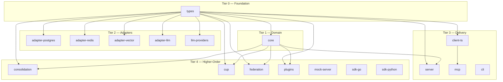

# Mnemosyne Architecture

Mnemosyne is a cognitive memory system for AI agents, implemented as an 18-package
pnpm + Turborepo monorepo. It follows **hexagonal (ports-and-adapters)** architecture:
all domain logic lives in `@mnemo-ai/core` and depends exclusively on abstract port
interfaces defined in `@mnemo-ai/types`. Infrastructure packages (Postgres, Redis,
vector search, LLMs) implement those interfaces but are never imported by core. This
keeps the domain testable with pure in-memory fakes and ensures infrastructure choices
can be swapped without touching business logic.

---

## Package Dependency Graph

`cli` depends only on Node built-ins. `mcp` is a thin adapter over `client-ts` only.
`server` wires `adapter-postgres` (and optionally `adapter-redis`, `llm-providers`) via
DI at startup — the server package itself has no infrastructure imports.

---

## Port–Adapter Mapping

| Port interface   | Concrete adapter(s)                                                                                          | Package              |
|------------------|--------------------------------------------------------------------------------------------------------------|----------------------|
| `StorageAdapter` | `DrizzleStorageAdapter`                                                                                      | `adapter-postgres`   |
| `CacheAdapter`   | `RedisCacheAdapter`                                                                                          | `adapter-redis`      |
| `VectorAdapter`  | `PgVectorAdapter` (pgvector HNSW)                                                                            | `adapter-vector`     |
| `EmbedAdapter`   | `BatchingEmbedAdapter` (batching wrapper; underlying provider via `@mnemo-ai/adapter-llm`)                  | `adapter-llm`        |
| `LLMAdapter`     | `LlmProviderAdapter` bridging `OpenAIProvider`, `AnthropicProvider`, `GoogleProvider`, `CohereProvider`, `MistralProvider`, `VoyageProvider`, `OllamaProvider` | `adapter-llm` / `llm-providers` |
| `QueueAdapter`   | `InMemoryQueueAdapter` (default in-process)                                                                  | `server`             |
| Outbox           | `OutboxWorker` (transactional relay, same Postgres DB)                                                       | `adapter-postgres`   |

All ports plus their input/filter types are defined in `packages/types/src/ports.ts`.
The `CoreContext` struct (see `packages/core/src/cognitive/context.ts`) is the dependency
bundle threaded through every domain function; `cache`, `llm`, `queue`, and `auth` are
optional — the system degrades gracefully when they are absent.

---

## Request Lifecycle: `POST /recall`

The route is `POST /recall` (the `v1` router is mounted at the app root, no prefix). The
`memory_recall` MCP tool calls the same route. Full description of each step:
`docs/internals/ALGORITHMS.md §1`.

1. **HTTP ingress** — `packages/server/src/routes/recall.ts` validates the body with zod;
   the auth middleware has already resolved the API key to a `workspaceId` and its
   sensitivity ceiling.
2. **Token-budget gate (opt-in)** — only when the request sends `tokenBudget` or the
   server sets `MNEMO_RECALL_DEFAULT_TOKEN_BUDGET`: `< 500` returns empty, `< 2000`
   consults the hot tier only, `< 8000` hot and pointer, `≥ 8000` everything. Without a
   budget the full cascade runs.
3. **Query embedding** — `EmbedAdapter.embedSingle(query)`, through an embedding cache.
   The vector width is the configured model's (bge-m3, the local default, is 1024). With
   `hyde: true` an LLM-written hypothetical answer is embedded and averaged in. If the
   provider does not answer, recall falls back to full-text search (strict
   `mode: "semantic"` answers 503 instead).
4. **L3 result cache** — a near-identical earlier query (cosine ≥ 0.95, ≤ 5 minutes old)
   reuses its result; only for the default, unfiltered request shape.
5. **Hot tier, then pointer tier** — Redis activation set and FTS ∪ LSH pointer lookup,
   facts only. Each answers only when at least 3 hits score above 0.7.
6. **Cold tier candidates** — HNSW over `mnemo_fact`, cosine over the other recallable
   kinds and entities, plus full-text arms in hybrid mode. Each candidate keeps its raw
   cosine and lexical rank apart.
7. **Eligibility** — validity, filters, sensitivity ceiling and the worth gate (facts:
   worth > 0.5 and Wilson lower bound ≥ 0.3, untested facts exempt).
8. **Relevance-first score** — `relevance × kindWeight × worthPrior × (1 + 0.02·tanh A)`.
   Relevance is the cosine; in hybrid mode with lexical evidence it is a reciprocal rank
   fusion (`k = 60`) between the semantic and the lexical ranking only. `kindWeight` is
   0.85 for entities, 1 otherwise; `worthPrior = 1 + 0.1·(worth − 0.5)`; `A` is the Petrov
   activation from `mnemo_recall_log`.
9. **Exact-content dedup and pagination** — identical contents collapse to one hit;
   `nothingRelevant` is judged before pagination.
10. **Page context** — open relations and hyperedge co-members are attached to each
    served hit as hints; they are never added as hits.
11. **Rerank (opt-in)** — only with `rerank: true` and an LLM configured, and skipped by
    the RecMem gate when the hits are thematically scattered.
12. **Response and effects** — `RecallHit[]` is returned (`projection: "compact"` cuts
    each hit to 300 characters). The delivered hits are recorded in `mnemo_recall_log`;
    the top 3 facts are promoted to the hot tier. `related` relations and Hebbian
    hyperedges are written from co-recall only when the host enables
    `recallGraphLearning`.

Full algorithm specification: `docs/internals/ALGORITHMS.md §1`.

---

## Hexagonal Rule

**Core must never import infrastructure.** The guard is a Vitest test that scans every
`.ts` file under `packages/core/src/` (tests excluded, plus a short reason-annotated
allowlist) and fails if any imports `drizzle-orm`, `pg`, `postgres`, `ioredis`, `redis`,
or `@neondatabase`:
`packages/core/src/__tests__/v3-purity.test.ts`.

---

## Where to Find Things

| I want to…                              | Go to                                                        |
|-----------------------------------------|--------------------------------------------------------------|
| Add a new port interface                | `packages/types/src/ports.ts`                                |
| Implement a new adapter                 | New package in `packages/adapter-*/`, implement the port     |
| Understand what adapters core receives  | `packages/core/src/cognitive/context.ts` (`CoreContext`)            |
| See how adapters are wired at startup   | `packages/server/src/index.ts` (`bootFromEnv`)               |
| Add a new HTTP route                    | `packages/server/src/` (Hono route file)                     |
| Understand the recall algorithm         | `docs/internals/ALGORITHMS.md §1`                            |
| Understand the data model               | `docs/architecture/DATA_MODEL.md`                            |
| Run the contract test suite for storage | `packages/types/src/testing/StorageAdapterContract.ts`       |
| Add a new migration                     | `packages/adapter-postgres/migrations/baseline/`                   |
| Check security / RLS policies           | `docs/architecture/SECURITY.md`                              |
| Understand consolidation / CUP          | `docs/internals/CONSOLIDATION.md`, `packages/consolidation/` |
