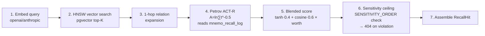

# Mnemosyne v3 — Architecture Overview

Mnemosyne is a multi-tenant cognitive memory system for AI agents. It stores
facts, decisions, episodes, and relations in a bitemporal Postgres database
and exposes them via an HTTP API and an MCP server. The system is built on
a hexagonal architecture: the domain layer (`@mnemo-ai/core`) has zero
knowledge of databases, caches, or LLM providers — it only depends on port
interfaces defined in `@mnemo-ai/types`.

> **Interactive diagrams (verified against code on 2026-09-11):** see
> [`diagrams/README.md`](diagrams/README.md). Where this page and the diagrams disagree,
> the diagrams are newer — this page still refers to `core/src/v3/` (now `core/src/cognitive/`)
> and to `searchMnemo` as the live `/recall` path (the route now calls
> `cognitive.recall` → `recallWithCaches`).

---

## System Tiers

```mermaid
flowchart TD
    A[AI Agent / Claude / Cursor] -->|MCP protocol| B[@mnemo-ai/mcp\n26 tools]
    B -->|HTTP + bearer token| C[@mnemo-ai/client-ts\nZero-dep SDK]
    C -->|HTTP| D[@mnemo-ai/server\nHono · OpenAPI 3.1\n43 route files]
    D -->|StorageAdapter port| E[@mnemo-ai/adapter-postgres\nDrizzle ORM · migrations 0001-0074]
    D -->|CacheAdapter port| F[@mnemo-ai/adapter-redis\nHot-tier recall]
    D -->|VectorAdapter port| G[@mnemo-ai/adapter-vector\npgvector HNSW]
    D -->|LLMAdapter port| H[@mnemo-ai/adapter-llm]
    H --> I[@mnemo-ai/llm-providers\nOpenAI · Anthropic]
    D -->|domain calls| J[@mnemo-ai/core v3/\nremember · forget · session · recall-cold ACT-R\nreachable via @mnemo-ai/core/v3]
    J -->|StorageAdapter port| E
    J -->|CacheAdapter port| F
    J -->|VectorAdapter port| G
    J -->|LLMAdapter port| H
```

**Cardinal rule:** `packages/core/src/v3/` has zero imports from `drizzle-orm`, `pg`,
`redis`, or `@neondatabase`. Enforced by `v3-purity.test.ts` and `types/purity.test.ts`.

---

## 7-Stage Cold Recall Pipeline (v3 ACT-R engine)

> **Which recall runs in production?** The HTTP `POST /recall` route calls
> `deps.core.recall()`, built by `createCore()` (the v1 factory), which routes to
> `searchMnemo()` in `packages/core/src/recall/search.ts` — the full-text (`ts_rank_cd`) + HyDE + dense +
> graph + optional LLM rerank **hybrid** search. That is the live `/recall` path.
>
> The 7-stage Petrov ACT-R cold cascade diagrammed below is a **separate engine**
> (`packages/core/src/v3/recall-cold.ts`). It is wired for remember/forget/session
> via `@mnemo-ai/core/v3` and is currently reachable through `@mnemo-ai/core/v3` —
> **not** through the production `/recall` HTTP route. In short:
> **Production `/recall` → `searchMnemo` (hybrid); the cascade below is the v3 engine.**



Stage 4 reads `mnemo_recall_log` (append-only, migration 0010). Degrades gracefully
to activation=0 when the log is empty (new fact).

---

## Package Dependency Rules

```
@mnemo-ai/types          — no dependencies (pure domain types + port interfaces)
@mnemo-ai/core (v3/)     — depends on @mnemo-ai/types only
@mnemo-ai/adapter-*      — depends on @mnemo-ai/types; never imported by core
@mnemo-ai/server         — depends on @mnemo-ai/core, @mnemo-ai/types, adapters
@mnemo-ai/mcp            — depends on @mnemo-ai/client-ts only
@mnemo-ai/client-ts      — no dependencies (native fetch)
```

---

## Key Invariants

| Invariant                                | Enforced by                                   |
| ---------------------------------------- | --------------------------------------------- |
| Core/v3 has no infra imports             | `v3-purity.test.ts`                           |
| Types has no infra imports               | `types/purity.test.ts`                        |
| Migrations run in order                  | `migrations.test.ts`                          |
| Sensitivity ceiling — numeric only       | `rbac.test.ts`                                |
| RLS ENABLE+FORCE on all workspace tables | Migrations + `schema-rls.integration.test.ts` |
| mnemo_recall_log append-only             | Migration 0010 (GRANT SELECT, INSERT only)    |

---

## Migrations

Stream: `packages/adapter-postgres/migrations/v3/`
Range: 0001 (baseline) → 0074 (outbox select grant)
Next: 0075

See `packages/adapter-postgres/migrations/v3/README.md` for per-migration summaries.
