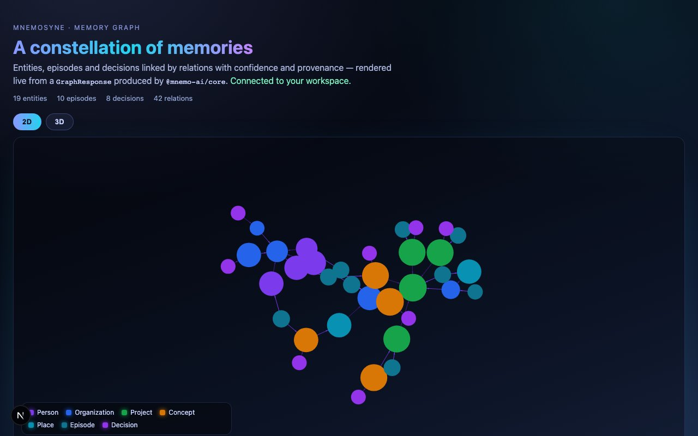

# 🌌 Visor del Memory Graph

[English](README.md) · **Español**

Un ejemplo ejecutable de Next.js 16 que dibuja un **Memory Graph de Mnemosyne**
(una constelación de entidades, episodios y decisiones) con
[`react-force-graph`](https://github.com/vasturiano/react-force-graph),
en **2D y 3D**.

Demuestra que [`@mnemo-ai/core`](../../packages/core) incluye todo lo que necesita
un frontend de grafos: un `GraphResponse` tipado, primitivas de color, tamaño y diseño seguras para el cliente,
y un servidor cuyo `GET /graph` responde con esa misma forma, **sin que llegue al paquete
del navegador ni código de base de datos ni la clave de API**.

## Qué muestra

- **`GET /graph` → `GraphResponse` → `react-force-graph`**: el flujo
  de datos completo, de extremo a extremo.
- **Color del nodo** asignado a partir de `GraphNode.kind` / `entityKind` mediante la tabla
  `ENTITY_KIND_COLOR` del paquete (persona, organización, proyecto, concepto, lugar,
  episodio, decisión).
- **Tamaño del nodo** a partir de `nodeRadius(mentionCount, …)` más un incremento por `factCount`, de modo que
  los nodos más recordados se vean más grandes.
- **Color y grosor de las aristas** a partir de `EDGE_STYLES[relation]` escalados por `confidence`
  (las mismas reglas que usa el helper de canvas `drawEdge` del paquete).
- **Diseño** dirigido por `defaultForceConfig()` del paquete, conectado directamente a
  la simulación de d3-force: prueba de que la configuración del diseño es real y se consume.

## El límite de importación (por qué es seguro)

| Dónde                                  | Importación                          | ¿Arrastra un controlador de base de datos? |
| -------------------------------------- | ------------------------------------ | ------------------------------------------ |
| `app/MemoryGraph.tsx` (`"use client"`) | `@mnemo-ai/core/graph`               | ❌ nunca                                   |
| `lib/load-graph.ts` (servidor)         | `fetch` al `GET /graph` del servidor | ❌ nunca (solo HTTP)                       |

El renderizador del cliente importa **solo** la entrada `@mnemo-ai/core/graph`, segura para el cliente.
El grafo viene de un servidor de Mnemosyne en marcha y se pide **solo desde el servidor**,
así que tu clave de API nunca llega al navegador.

## Ejecútalo

El ejemplo usa `@mnemo-ai/core` desde el workspace, que no está en npm: corre dentro de
este repositorio y primero hay que compilar core.

```bash
# from the monorepo root
pnpm install
pnpm --filter "graph-viewer^..." build
pnpm --filter graph-viewer dev
```

Abre <http://localhost:3000>. Sin `MNEMO_URL` definida, muestra el grafo
de ejemplo incluido (`lib/sample-graph.ts`): **cero configuración**. Alterna **2D / 3D** en la
esquina superior izquierda; pasa el cursor sobre un nodo o una arista para ver su etiqueta, tipo, relación y confianza.

## Usa tus propios datos

Copia `.env.example` → `.env.local` y define:

```bash
MNEMO_URL=http://localhost:3939
MNEMO_KEY=mns_live_...
```

Reinicia `pnpm --filter graph-viewer dev`. La página y `/api/graph` muestran ahora
el espacio de trabajo de esa clave, leído del `GET /graph` del servidor. Las memorias
por encima del techo de sensibilidad de la clave quedan fuera del grafo.

## Captura de pantalla



## Archivos

```
graph-viewer/
├─ app/
│  ├─ layout.tsx          # space-themed shell (radial glow + aurora)
│  ├─ page.tsx            # server component — loads the GraphResponse
│  ├─ MemoryGraph.tsx     # "use client" — react-force-graph, 2D/3D, legend
│  └─ api/graph/route.ts  # GET: the live graph OR the bundled fixture
├─ lib/load-graph.ts      # server-only: GET /graph with MNEMO_URL + MNEMO_KEY
├─ lib/sample-graph.ts    # zero-setup GraphResponse fixture
├─ next.config.mjs        # transpilePackages: ["@mnemo-ai/core"]
└─ .env.example           # MNEMO_URL + MNEMO_KEY (optional)
```
