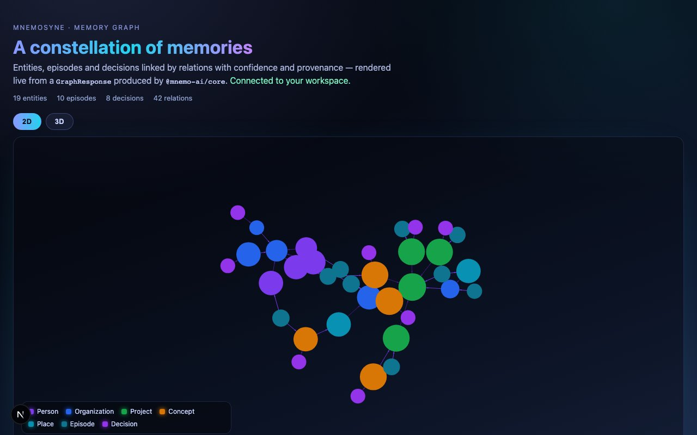

# 🌌 Memory Graph Viewer

**English** · [Español](README.es.md)

A runnable Next.js 16 example that renders a **Mnemosyne Memory Graph** —
a constellation of entities, episodes and decisions — with
[`react-force-graph`](https://github.com/vasturiano/react-force-graph),
in **2D and 3D**.

It proves that [`@mnemo-ai/core`](../../packages/core) ships everything a
graph frontend needs: a typed `GraphResponse`, client-safe color/size/layout
primitives, and a server whose `GET /graph` answers in that exact shape — with
**no database code and no API key crossing into the browser bundle**.

## What it shows

- **`GET /graph` → `GraphResponse` → `react-force-graph`** — the full
  data flow, end to end.
- **Node color** mapped from `GraphNode.kind` / `entityKind` via the package's
  `ENTITY_KIND_COLOR` table (person, organization, project, concept, place,
  episode, decision).
- **Node size** from `nodeRadius(mentionCount, …)` plus a `factCount` bump, so
  the most-remembered nodes read largest.
- **Edge color & width** from `EDGE_STYLES[relation]` scaled by `confidence`
  (the same rules the package's `drawEdge` canvas helper uses).
- **Layout** driven by the package's `defaultForceConfig()` wired straight into
  the d3-force simulation — proof the layout config is real and consumed.

## The import boundary (why this is safe)

| Where                                  | Import                               | Pulls in a DB driver? |
| -------------------------------------- | ------------------------------------ | --------------------- |
| `app/MemoryGraph.tsx` (`"use client"`) | `@mnemo-ai/core/graph`               | ❌ never              |
| `lib/load-graph.ts` (server)           | `fetch` to the server's `GET /graph` | ❌ never (HTTP only)  |

The client renderer imports **only** the client-safe `@mnemo-ai/core/graph`
entry. The graph itself comes from a running Mnemosyne server, fetched **on the
server only**, so your API key never reaches the browser.

## Run it

The example reads `@mnemo-ai/core` from the workspace, which is not on npm, so
it runs inside this repository and core has to be built first.

```bash
# from the monorepo root
pnpm install
pnpm --filter "graph-viewer^..." build
pnpm --filter graph-viewer dev
```

Open <http://localhost:3000>. With no `MNEMO_URL` set it renders the bundled
sample graph (`lib/sample-graph.ts`) — **zero setup**. Toggle **2D / 3D** in the
top-left; hover a node or edge for its label, kind, relation and confidence.

## Use your own data

Copy `.env.example` → `.env.local` and set:

```bash
MNEMO_URL=http://localhost:3939
MNEMO_KEY=mns_live_...
```

Restart `pnpm --filter graph-viewer dev`. The page and `/api/graph` now show
the workspace that key belongs to, read from the server's `GET /graph`. Any
memory above the key's sensitivity ceiling stays out of the graph.

## Screenshot



## Files

```
graph-viewer/
├─ app/
│  ├─ layout.tsx          # space-themed shell (radial glow + aurora)
│  ├─ page.tsx            # server component — loads the GraphResponse
│  ├─ MemoryGraph.tsx     # "use client" — react-force-graph, 2D/3D, legend
│  └─ api/graph/route.ts  # GET: the live graph OR the bundled fixture
├─ lib/load-graph.ts      # server-only: GET /graph with MNEMO_URL + MNEMO_KEY
├─ lib/sample-graph.ts    # zero-setup GraphResponse fixture
├─ next.config.mjs        # transpilePackages: ["@mnemo-ai/core"]
└─ .env.example           # MNEMO_URL + MNEMO_KEY (optional)
```
